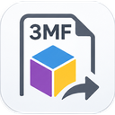

  

<h1 align="center">3MFStudio</h1>

  <strong>Allplan bodies to the 3D printer – and 3MF files back into Allplan.</strong> 
  A PythonPart for Allplan 2027.

  
  
  
  
  

<a href="README.md">Deutsch</a>

---

3MFStudio writes 3D bodies from Allplan as a **3MF file** for 3D printing – each body gets a filament,
names and colours arrive in the slicer. The other way round it reads 3MF files and places their bodies as
clean Allplan bodies. Everything is operated in a small window above Allplan.

> **Private project.** 3MFStudio is a spare-time project with no affiliation to Nemetschek/ALLPLAN or
> Bambu Lab. It is provided as is – without warranty and without liability. Details:
> [HAFTUNGSAUSSCHLUSS.md](HAFTUNGSAUSSCHLUSS.md) (German and English).

## Features

| | |
|---|---|
| 🧱 **Bodies → 3MF** | Click bodies, assign a filament (up to 16), write the file. Nested bodies stay one object; the smaller one wins the shared volume (lettering in a plate). |
| 🎨 **Colour and material per filament** | Pick from a list of real filaments (161 brands, Bambu Lab first) or type your own colour. Allplan recolours the bodies. ⇅ swaps the bodies of two filaments. |
| 🔗 **Element groups stay together** | Bodies of an Allplan element group become **one** part named after the group – recoloured with one click in the slicer. |
| 🖨️ **Bambu project right away** | With Bambu Studio as your slicer, the written file is the Bambu project itself: colours, materials (PLA, PETG …) and the printer set in your Bambu Studio. Double-click and go. |
| 📐 **Build plate in the model** | Printer from a list (93) or custom size: plate with its top at Z = 0, centred at X/Y = 0, build volume optionally as lines. Never written to the file. |
| ⬅️ **3MF → Allplan** | Import 3MF files: bodies without a triangle mesh, filament colours and assignment come along; parts with a constant cross-section get smooth round faces. |
| 🌍 **German / English** | Follows Allplan's language. |

## Quick start

**Requirement:** Allplan 2027 on Windows. Nothing else. Bambu Studio is optional.

1. Download the latest `3MFStudio-<version>.allep` from the [releases page](../../releases/latest).
2. Start Allplan 2027 and drag the `.allep` file into the Allplan window.
3. Follow the Plugin Manager, then restart Allplan once.

The tool appears in the **library under Private › Willi Liffers › 3MFStudio** and among the plug-ins of the
Actionbar configuration. Updates work the same way; uninstall via the Plugin Manager. Manual installation
without the Plugin Manager: see [LIESMICH_Installation.txt](LIESMICH_Installation.txt) (English part at the end).

**Using it:** start the tool → press **Select** on a filament, click bodies in the model, **Done** → tap the
colour tile to choose colour and material → **Write 3MF** → open the file in your slicer (**Open in slicer**
or a double-click). **Import 3MF** places the bodies of a file with one click in the model.

## Bambu Studio

3MFStudio works **without** Bambu Studio. If Bambu Studio is installed and is your slicer, writing does more:
Bambu Studio builds a Bambu project from the neutral file via its command line (its window is never remote
controlled) and 3MFStudio stores that project under the chosen name – with colours, materials and the
printer currently set in your Bambu Studio. Tick **"Write a universal 3MF"** in the gear for a neutral file.

## What goes where

- **Into the 3MF file:** geometry, filament assignment, part names; for a Bambu project also colours,
  materials and the printer profile. **No** project data, attributes or paths from Allplan.
- **On your machine:** settings in `%APPDATA%\3MFStudio\einstellungen.json`, a log in
  `Documents\3MFStudio_debug.log`. Bambu Studio's settings and profiles are only **read**.
- **To the internet:** nothing.

## Limits

Free-form shapes import as planar faces (smooth round faces only for constant cross-sections). Painted
colours from the slicer are not imported (you get a note). No build-volume warnings – the build plate in the
model helps you judge. On-screen colours are approximations (Allplan has 255 fixed colours).

## For developers

`src/` program (`3MFStudio.py` + `threemf_*.py`, the latter testable without Allplan) · `tests/` pytest ·
`build_allep.py` package · `deploy.py` direct deploy into Allplan · `docs/messungen/` measurement protocols
on how Bambu Studio reads foreign 3MF files. `python -m pytest tests` takes about 7 minutes.
Release steps: [docs/RELEASING.md](docs/RELEASING.md) (German).

## Liability and licence

MIT licence ([LICENSE](LICENSE)). Use at your own risk; check geometry and print files before printing or
passing them on, and back up your Allplan projects – see [HAFTUNGSAUSSCHLUSS.md](HAFTUNGSAUSSCHLUSS.md).
Third-party parts: [THIRD_PARTY_NOTICES.md](THIRD_PARTY_NOTICES.md). ALLPLAN is a trademark of ALLPLAN GmbH /
Nemetschek Group; Bambu Lab and Bambu Studio are trademarks of Bambu Lab. 3MFStudio is independent of both.

Version 1.1.2 · last reviewed 2026-11-08

