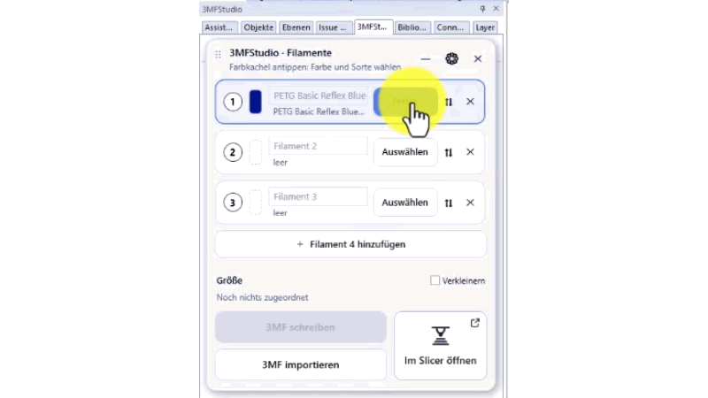

  

<h1 align="center">3MFStudio</h1>

  <strong>3MFStudio connects Allplan with 3D printing.</strong> 
  A PythonPart for Allplan 2027.

  
  
  
  
  

  
  

  <a href="#features">Features</a> ·
  <a href="#installation">Installation</a> ·
  <a href="#export-from-allplan">Export</a> ·
  <a href="#import-into-allplan">Import</a> ·
  <a href="#universal-3mf-file-and-bambu-project">3MF and Bambu project</a> ·
  <a href="#limitations">Limitations</a> ·
  <a href="#liability-and-licence">Liability &amp; licence</a> ·
  <a href="README.md">Deutsch</a>

---

  

Shown with the German interface. The interface follows Allplan's language setting.

With 3MFStudio you export 3D bodies from Allplan 2027 as 3MF files and import existing 3MF models back into
Allplan. For multi-colour printing you assign filaments to the bodies. If Bambu Studio is installed,
3MFStudio additionally saves colours, material types and print profiles in a Bambu project.

You work in a compact window directly in Allplan. The interface language follows Allplan's language setting
(German or English).

> **Private project.** 3MFStudio is a spare-time project with no affiliation to Nemetschek, ALLPLAN or
> Bambu Lab. The software is provided without warranty and without liability. Details are in the
> [disclaimer](HAFTUNGSAUSSCHLUSS.md) (German and English).

## Features

**Export bodies for multi-colour printing.**
You select bodies in the model and assign them to one of up to 16 filaments. 3MFStudio saves them as a 3MF
file with part names and a filament number per part.

**Choose colour and filament.**
For each filament you choose brand, filament series and colour from a bundled list of real filaments
(161 brands, Bambu Lab first). The filament series determines the material type, for example PLA or PETG.
Alternatively you enter a colour value of your own. The bodies in Allplan receive the closest of the 255
Allplan colours, so the model reflects the later colour distribution.

**Swap filaments.**
⇅ swaps the bodies of two filaments. Name, colour and filament series stay with their filament card. This
helps when an inner body is hard to click in the model.

**Keep element groups together.**
Bodies that belong to an Allplan element group and share a filament are exported as one part named after
the group. In the slicer you recolour that part in one step.

**The assignment stays with the body.**
3MFStudio writes the filament as attribute **3MF-Filament** to every assigned body. If you edit, move, copy
or apply Boolean operations to bodies in Allplan, the assignment is kept; a copy comes with its filament.
When bodies are united (Boolean union), the filament of the body clicked first applies. Writing the file reads the current
shape of each body, and after an Allplan restart the assignment is back.

**Build volume and build plate for orientation.**
The cube icon next to the gear opens the build volume card. Pick a printer from a list of 93 models or enter
a custom X, Y and Z size; every change is saved at once. **Place build plate** puts the plate into the
model: top face at Z = 0, centre at X/Y = 0, optionally with the build volume as 3D lines. Plate and lines
lie on layer **KO_HK** (construction aid). Nothing on this layer is exported – including your own helper
bodies placed there.

**Import 3MF files.**
3MFStudio reads 3MF files and places their parts as Allplan bodies. Filament colours and the assignment of
parts to filaments are taken over if the file contains them. The kind of body depends on the geometry; see
[Import into Allplan](#import-into-allplan).

### Overlapping bodies

Bodies that touch or are nested inside each other are exported as one shared object, so their position
relative to each other is kept in the slicer. The volume two bodies share is printed with the filament of the
smaller body. For bodies of equal size, the filament of the body assigned last applies.

*Example:* Lettering sits 1 mm deep in a base plate. The letters are printed entirely with their own
filament; the base plate is left out at those places.

Bodies with a gap between them become separate objects that the slicer can arrange individually.

## Installation

**Requirement:** Allplan 2027 on Windows. Bambu Studio is optional.

1. Download the latest `3MFStudio-<version>.allep` from the [releases page](../../releases/latest).
2. Start Allplan 2027 and drag the `.allep` file into the Allplan window.
3. Follow the Plugin Manager, then restart Allplan.

3MFStudio then appears in the library under **Private › Willi Liffers › 3MFStudio** and among the plug-ins
of the Actionbar configuration. Updates are installed the same way. Uninstall via the Plugin Manager.
Manual installation without the Plugin Manager is described in
[LIESMICH_Installation.txt](LIESMICH_Installation.txt) (English part at the end).

## Export from Allplan

1. Start 3MFStudio. The window opens above the Allplan model.
2. Click **Select** on a filament, pick the bodies in the model and click **Done**.
3. Click the colour swatch of the filament card. Choose **Brand**, **Type** (the filament series, for example
   "PLA Basic") and a colour, or enter a colour value via **Own colour**.
4. Repeat steps 2 and 3 for further filaments.
5. Click **Write 3MF** and choose location and file name.
6. Open the file in your slicer, either with **Open in slicer** or from Explorer.

Bodies are exported at original size. **Scale down** lets you choose a scale.

## Import into Allplan

1. Start 3MFStudio and click **Import 3MF**.
2. Choose the 3MF file. The parts then follow the mouse pointer.
3. Click the placement point in the model.

Which bodies are created:

- **Closed parts with planar faces** become solid bodies. Adjacent triangles in one plane are merged into
  one face, so no triangulation remains visible.
- **Parts with a constant cross-section**, such as puzzle pieces or plug shapes, receive smooth rounded
  faces. 3MFStudio compares volume, surface area and dimensions with the original and uses the smooth shape
  only if it matches within tight tolerances.
- **Predominantly rounded free-form shapes** such as figures remain bodies made of triangular faces.
- **Parts with an open mesh** are placed as surface bodies. 3MFStudio points this out after the import.
- **Painted parts** (colour on individual faces) are imported with one colour. The painting itself is not
  imported; 3MFStudio points this out as well.
- **Standard 3MF colours**, as written by other programs, become filaments with their colour.
- **Files 3MFStudio cannot read safely** are refused with a reason: files requiring an unsupported extension
  (for example Beam Lattice, Slice or Production Alternatives), encrypted files and damaged files.

## Universal 3MF file and Bambu project

3MFStudio saves either a universal 3MF file or a Bambu project. Which one is shown in the settings (gear)
below the option **Write a universal 3MF**.

| Content | Universal 3MF file | Bambu project |
|---|---|---|
| Geometry and part names | ✓ | ✓ |
| Filament number per part | ✓ ¹ | ✓ |
| Filament colours | – | ✓ |
| Material type and filament profile per filament | – | ✓ |
| Printer and print profile | – | ✓ ² |

¹ Stored in a Bambu Studio metadata file. Whether another slicer reads this assignment depends on the slicer;
Bambu Studio has been checked.
² The printer currently set in Bambu Studio is used. If none is found, the printer is left open in the
project.

**When is a Bambu project created?** When Bambu Studio is installed, counts as the slicer and the option
**Write a universal 3MF** is off. Bambu Studio counts as the slicer if it is chosen under **Slicer program**
in the settings, or if Windows opens 3MF files with it. In that case a double-click on the saved file opens
the project in Bambu Studio with colours, material types and printer.

**Where the profiles come from:** For the chosen filament 3MFStudio looks up the matching filament profile in
the Bambu Studio installation. If there is no specific profile, the generic profile of the material type is
used (for example "Generic PETG"). Filaments without a choice receive the filament set in the corresponding
slot in Bambu Studio.

Without Bambu Studio, or if the project cannot be created, 3MFStudio saves the universal file and says so.
You then set colours and material types in the slicer.

## Data saved and read

- **In the 3MF file:** the contents from the table above. No project data, attributes or file paths from
  Allplan are exported.
- **In the Allplan model:** the user attribute `3MF-Filament` (filament number 1–16) on assigned bodies.
  3MFStudio creates it in the project on the first assignment.
- **On your computer:** settings in `C:\Users\<USER>\AppData\Roaming\3MFStudio\einstellungen.json` and a
  log for troubleshooting in `C:\Users\<USER>\Documents\3MFStudio_debug.log`.
- **From Bambu Studio:** settings and profiles are only read, never changed.
- **Internet:** 3MFStudio makes no connection and sends no data.

## Limitations

- Rounded free-form shapes are not converted into smooth faces on import (see above).
- Painting on individual faces is not imported.
- 3MFStudio does not check whether a model fits the build volume. The build plate helps you judge this.
- Mandatory 3MF extensions other than Production, Materials and Triangle Sets are not supported; such files
  are refused (see above).
- Name, colour and filament series of the filament cards are not stored in the model. After an Allplan
  restart the assignment is back, but the cards show the Allplan colour of the bodies again.
- Assigned bodies are searched in all editable loaded drawing files. Bodies of another print job loaded
  there are written to the file as well.
- On-screen colours are approximations. The printed filament may differ.
- If something fails, the reason is in the log `C:\Users\<USER>\Documents\3MFStudio_debug.log`.

## Feedback

Bug reports and suggestions are welcome as issues. Helpful details are the Allplan version, the Bambu Studio
version if involved, and the last lines of the log. 3MFStudio is maintained in my spare time. I reply as soon
as I can, but cannot promise response times or fixes. See [CONTRIBUTING.md](CONTRIBUTING.md) (German).

## For developers

`src/` program (`3MFStudio.py` and `threemf_*.py`, the latter testable without Allplan) · `tests/` pytest ·
`build_allep.py` package · `deploy.py` direct deploy into Allplan · `docs/messungen/` measurement protocols on
how Bambu Studio reads foreign 3MF files. `python -m pytest tests` takes about 7 minutes.
`python fetch_conformance.py` fetches the 3MF Consortium conformance suites and the lib3mf checker (Node.js 22)
into `conformance/`; without it those tests are skipped.

**Internal handling of the Bambu project:** 3MFStudio first saves the universal file. Bambu Studio's command
line then builds the project from it, which replaces the universal file. Bambu Studio's window is not
controlled. Allplan loads the main script once per session; restart Allplan after a deploy. Release steps:
[docs/RELEASING.md](docs/RELEASING.md) (German).

## Liability and licence

MIT licence ([LICENSE](LICENSE)). Use at your own risk; check geometry and print files before printing or
passing them on, and back up your Allplan projects – see [HAFTUNGSAUSSCHLUSS.md](HAFTUNGSAUSSCHLUSS.md).
Third-party parts: [THIRD_PARTY_NOTICES.md](THIRD_PARTY_NOTICES.md). ALLPLAN is a trademark of ALLPLAN GmbH /
Nemetschek Group; Bambu Lab and Bambu Studio are trademarks of Bambu Lab. 3MFStudio is independent of both.

Version 1.1.4 · last reviewed 2026-11-09

