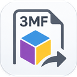

<p align="center">
  
</p>

<h1 align="center">3MFStudio</h1>

<p align="center">
  <strong>Allplan-Körper in den 3D-Drucker – und 3MF-Dateien zurück nach Allplan.</strong><br>
  Ein PythonPart für Allplan 2027.
</p>

<p align="center">
  
  
  
  <a href="LICENSE"></a>
  
</p>

<p align="center">
  <a href="#schnellstart">Schnellstart</a> ·
  <a href="#was-3mfstudio-kann">Funktionen</a> ·
  <a href="#bambu-studio">Bambu Studio</a> ·
  <a href="#fragen-und-grenzen">Grenzen</a> ·
  <a href="#für-entwickler">Für Entwickler</a> ·
  <a href="#haftung-und-lizenz">Haftung &amp; Lizenz</a> ·
  <a href="README.en.md">English</a>
</p>

---

3MFStudio schreibt 3D-Körper aus Allplan als **3MF-Datei** für den 3D-Druck – jeder Körper bekommt ein
Filament, Name und Farbe kommen im Slicer an. Umgekehrt liest es 3MF-Dateien und setzt ihre Körper als
saubere Allplan-Körper ab. Bedient wird alles in einem kleinen Fenster über Allplan; es gibt keine
Palette zum Durchklicken.

> **Privates Projekt.** 3MFStudio entsteht in der Freizeit, ohne Verbindung zu Nemetschek/ALLPLAN oder
> Bambu Lab. Es wird so bereitgestellt, wie es ist – ohne Gewährleistung und ohne Haftung.
> Einzelheiten: [HAFTUNGSAUSSCHLUSS.md](HAFTUNGSAUSSCHLUSS.md).

## Was 3MFStudio kann

| | |
|---|---|
| 🧱 **Körper → 3MF** | Körper anklicken, Filament zuweisen (bis 16), Datei schreiben. Ineinander steckende Körper bleiben ein Objekt; der kleinere gewinnt den gemeinsamen Bereich (Schrift in einer Platte). |
| 🎨 **Farbe und Sorte je Filament** | Aus einer Liste echter Filamente wählen (161 Hersteller, Bambu Lab zuerst) oder eine eigene Farbe eintippen. Allplan färbt die Körper gleich mit. ⇅ tauscht die Körper zweier Filamente. |
| 🔗 **Elementgruppen bleiben zusammen** | Körper einer Allplan-Elementgruppe werden in der Datei **ein** Teil mit dem Namen der Gruppe – im Slicer mit einem Klick umzufärben. |
| 🖨️ **Bambu-Projekt direkt** | Ist Bambu Studio dein Slicer, ist die geschriebene Datei gleich das Bambu-Projekt: Farben, Sorten (PLA, PETG …) und dein in Bambu eingestellter Drucker. Doppelklick genügt. |
| 📐 **Druckplatte im Modell** | Drucker aus einer Liste (93) oder eigene Maße: Platte mit Oberseite auf Z = 0, Mitte auf X/Y = 0, Bauraum auf Wunsch als Linien. Kommt nie in die Datei. |
| ⬅️ **3MF → Allplan** | 3MF-Dateien importieren: Körper ohne Dreiecksnetz, Filamentfarben und -zuordnung kommen mit; Teile mit gleichbleibendem Querschnitt bekommen glatte, runde Flächen. |
| 🌍 **Deutsch / Englisch** | Steht Allplan auf Deutsch, spricht 3MFStudio Deutsch, sonst Englisch. |

<!-- Screenshot: docs/images/fenster.png (Fenster über Allplan mit zwei Filamentkarten) -->

## Schnellstart

**Voraussetzung:** Allplan 2027 unter Windows. Sonst nichts. Bambu Studio ist optional.

### Installieren

1. Die neueste `3MFStudio-<Version>.allep` von der [Release-Seite](../../releases/latest) laden.
2. Allplan 2027 starten und die `.allep`-Datei mit der Maus in das Allplan-Fenster ziehen.
3. Den Meldungen des Plugin-Managers folgen, danach Allplan einmal neu starten.

Das Werkzeug liegt dann in der **Bibliothek unter Privat › Willi Liffers › 3MFStudio** und in der
Actionbar-Konfiguration unter den Plug-ins. Ein Update geht genauso; deinstallieren über den Plugin-Manager.

<details>
<summary>Ohne Plugin-Manager installieren</summary>

1. Allplan beenden.
2. Aus `3MFStudio_Installation.zip` den Inhalt des Ordners `Manuell` in den Allplan-Benutzerordner
   `…\Usr\Local\` kopieren (meist `Dokumente\Nemetschek\Allplan\2027\Usr\Local\`).
3. Allplan starten. Das Werkzeug liegt in der Bibliothek unter Privat › Willi Liffers.

Bitte nur **einen** der beiden Wege benutzen. Ausführlich: [LIESMICH_Installation.txt](LIESMICH_Installation.txt).
</details>

### Benutzen

1. **Werkzeug starten** – ein kleines Fenster erscheint über Allplan.
2. Bei einem Filament **„Auswählen“** drücken, die Körper im Modell anklicken, **„Fertig“**.
   Farbkachel antippen, um Farbe und Sorte zu wählen.
3. **„3MF schreiben“** – Datei wählen. Danach **„Im Slicer öffnen“** oder einfach Doppelklick auf die Datei.
4. **„3MF importieren“** – Datei wählen, die Körper hängen am Mauszeiger, ein Klick setzt sie ab.

Dauert ein Schritt länger als drei Sekunden, zeigt ein Ladefenster den Fortschritt.

## Bambu Studio

3MFStudio funktioniert **ohne** Bambu Studio. Ist Bambu Studio aber installiert und dein Slicer
(Zahnrad im Fenster, oder Windows öffnet 3MF-Dateien damit), passiert beim Schreiben mehr:

- Bambu Studio baut im Hintergrund über seine Kommandozeile aus der neutralen Datei ein **Bambu-Projekt**
  und 3MFStudio legt dieses unter dem gewählten Namen ab. Farben und Sorten sind drin.
- Der Drucker im Projekt ist der, der in deinem Bambu Studio gerade eingestellt ist – samt Druckprofil
  und passenden Filamentprofilen. Fächer ohne gewählte Sorte bekommen das Filament, das in Bambu in
  diesem Fach steckt. Findet 3MFStudio keinen Drucker, bleibt er im Projekt offen.
- Das Fenster von Bambu Studio wird nie ferngesteuert; es läuft nur dessen Kommandozeile.
- Willst du eine neutrale Datei für andere Programme: im Zahnrad **„Universelle 3MF schreiben“** anhaken.
  Die Zeile darunter sagt dir immer, was die nächste Datei wird.

Ohne Bambu Studio lesen OrcaSlicer, PrusaSlicer & Co. die neutrale Datei mit Teilnamen und
Filamentnummern; Sorten und Farben stellst du dort selbst ein.

## Was in die Datei kommt – und was nicht

- **In die 3MF-Datei:** Geometrie, Filamentzuordnung, Teilnamen. Bei einem Bambu-Projekt zusätzlich
  Farben, Sorten und Druckerprofil. **Keine** Projektdaten, Attribute oder Pfade aus Allplan.
- **Auf deinem Rechner:** Einstellungen unter `%APPDATA%\3MFStudio\einstellungen.json`, ein Protokoll
  unter `Dokumente\3MFStudio_debug.log` (für die Fehlersuche). Bambu Studios Einstellungsdatei und
  Profile werden nur **gelesen**, nie verändert.
- **Ins Internet:** nichts. 3MFStudio lädt nichts nach und sendet nichts.

## Fragen und Grenzen

- **Rundungen beim Import.** Glatte, runde Flächen entstehen für Teile mit gleichbleibendem Querschnitt
  (Puzzleteile, Steckformen). Freiformen (Figuren, organische Formen) kommen als ebene Flächen an.
- **Bemalte Modelle.** Farbbemalung aus dem Slicer (Pinselfarben auf Flächen) wird nicht übernommen;
  3MFStudio sagt das beim Import.
- **Bauraum.** 3MFStudio warnt nicht, wenn ein Modell größer als die Druckplatte ist – das sieht man
  im Slicer. Die Druckplatte im Modell hilft beim Einschätzen.
- **Farben am Bildschirm** sind Näherungen; Allplan hat 255 feste Farben, 3MFStudio nimmt die nächste.
- Schlägt etwas fehl, steht der Grund im Protokoll `Dokumente\3MFStudio_debug.log`.

## Für Entwickler

```
src/                  Programm: 3MFStudio.py (Script Object) + threemf_*.py (reine Rechnung, ohne Allplan testbar)
tests/                pytest, läuft ohne Allplan (Tests mit echtem Bambu Studio werden sonst übersprungen)
assets/               Icons für Bibliothek und Actionbar
docs/messungen/       Messprotokolle: wie Bambu Studio fremde 3MF-Dateien liest (G1, G2)
build_allep.py        baut dist/3MFStudio-<Version>.allep und das Installations-ZIP
build_filaments.py    frischt die Farbliste aus der Open Filament Database auf (src/threemf_filaments.json.gz)
build_printers.py     frischt die Druckerliste auf (src/threemf_printers.json)
deploy.py             kopiert das Werkzeug direkt in eine Allplan-Installation (Entwicklung)
publish_repo.py       stellt diesen Repo-Ordner aus dem Arbeitsprojekt zusammen und prüft auf Pfade/Geheimnisse
```

```bash
python -m pytest tests          # etwa 7 Minuten; ohne Bambu Studio werden dessen Tests übersprungen
python deploy.py                # nach Allplan 2027 (Usr\Local); mit --force bei laufendem Allplan
python build_allep.py           # Paket bauen; VERSION in build_allep.py vorher erhöhen
```

Allplan lädt das Hauptskript nur einmal je Sitzung; nach einem Deploy Allplan neu starten.
Wie ein Release entsteht: [docs/RELEASING.md](docs/RELEASING.md).

## Mitmachen

Fehlermeldungen und Ideen gern als Issue – mit Allplan-Version, Bambu-Studio-Version (falls beteiligt)
und den letzten Zeilen aus `Dokumente\3MFStudio_debug.log`. Mehr in [CONTRIBUTING.md](CONTRIBUTING.md).
Es gibt keinen Anspruch auf Antwort oder Behebung; das ist ein Freizeitprojekt.

## Haftung und Lizenz

- **Lizenz:** [MIT](LICENSE) – frei nutzbar, auch im Betrieb, ohne Gewährleistung.
- **Haftungsausschluss:** Benutzung auf eigene Gefahr. Prüfe Geometrie und Druckdateien, bevor du
  druckst oder weitergibst, und sichere deine Allplan-Projekte. [HAFTUNGSAUSSCHLUSS.md](HAFTUNGSAUSSCHLUSS.md)
- **Fremdanteile:** Farbliste aus der [Open Filament Database](https://github.com/OpenFilamentCollective/open-filament-database)
  (MIT). Alles Weitere in [THIRD_PARTY_NOTICES.md](THIRD_PARTY_NOTICES.md).
- **Marken:** ALLPLAN ist eine Marke der ALLPLAN GmbH / Nemetschek Group. Bambu Lab und Bambu Studio sind
  Marken von Bambu Lab. 3MFStudio ist ein unabhängiges Projekt und mit keinem der Genannten verbunden.

---

<p align="center">Stand: 1.1.2 · zuletzt geprüft am 2026-11-08</p>
